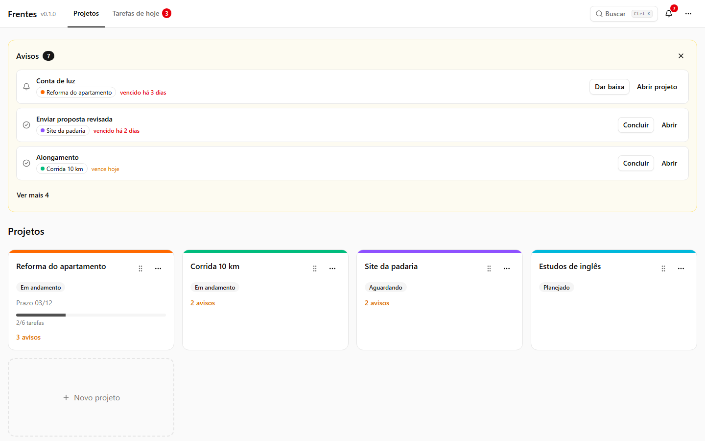
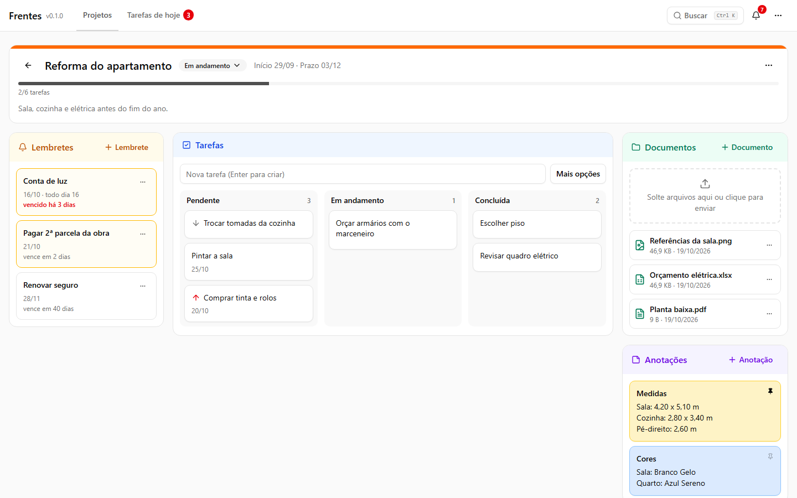
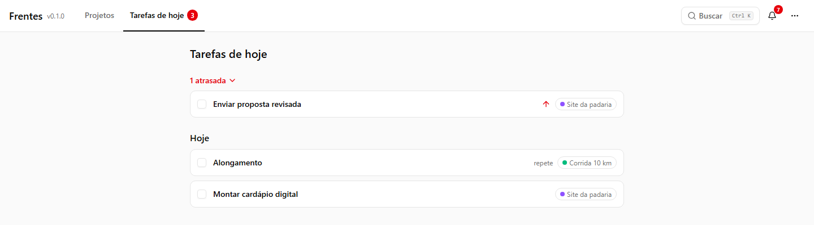
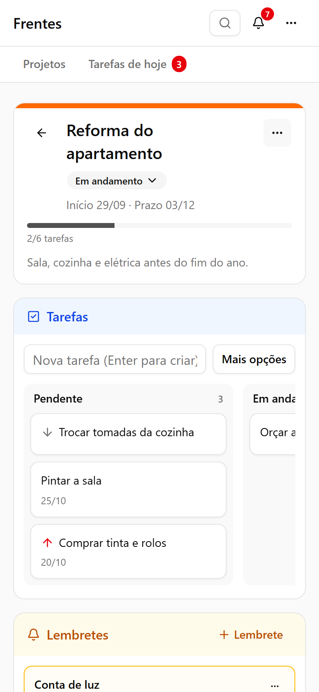
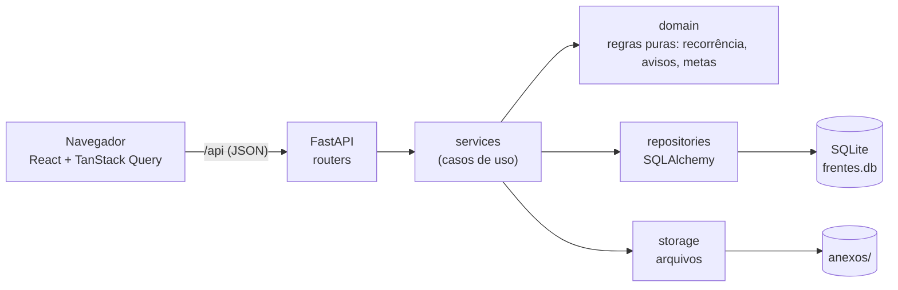

# Frentes

[](https://github.com/RenanAlvares/frentes/actions/workflows/ci.yml)
[](LICENSE)

**Gestor de projetos e tarefas que roda no seu computador.** Cada frente de trabalho vira um projeto com tarefas (simples, repetidas ou metas mensais), lembretes com antecedência, documentos e anotações. Ao abrir o app, um painel mostra o que vence nos próximos dias e o que já venceu.

<!-- GIF de 20–30 s: grave com o ScreenToGif (ou similar), salve em docs/img/demo.gif e troque este comentário por:

-->



## Funcionalidades

- **Projetos** com cor, status, prazo e barra de progresso opcional; arraste para reordenar; projetos concluídos vão para Arquivados.
- **Quadro de tarefas** (Pendente · Em andamento · Concluída) com arrastar e soltar, pelo mouse ou pelo teclado. Três tipos de tarefa:
  - **simples**, com prazo opcional;
  - **repetida**: a cada N dias, semanas (escolhendo os dias), meses ou anos; concluir avança para a próxima data;
  - **meta mensal**: "treinar 12 vezes no mês", com +1 / −1 e virada de mês automática.
- **Lembretes** com antecedência configurável e repetição; "dar baixa" num lembrete atrasado mostra quantas ocorrências foram perdidas.
- **Painel de avisos** ao abrir o app e sino com o total: lembretes na janela, tarefas perto do prazo e metas no fim do mês.
- **Tarefas de hoje**: atrasadas e do dia, de todos os projetos, num lugar só.
- **Documentos**: solte arquivos na área, com progresso por arquivo; PDF e imagens abrem no navegador, o resto é baixado.
- **Anotações** coloridas, com fixar no topo.
- **Busca global** (`Ctrl+K` ou `/`) em tudo, sem diferenciar acentos nem maiúsculas.
- **Lixeira com Desfazer**: toda exclusão pode ser desfeita na hora e fica 30 dias na lixeira.
- **Backup** em `.zip` (banco + documentos) e restauração pela linha de comando.
- Atalhos de teclado, navegação completa por teclado e layout que funciona no celular.

| Projeto aberto | Tarefas de hoje | No celular |
| --- | --- | --- |
|  |  |  |

## Decisões técnicas

Cada decisão está registrada, com motivo e consequência, em [`docs/09-decisoes.md`](docs/09-decisoes.md). As principais:

- **Local-first, um processo só.** FastAPI serve a API e o front-end (React) na mesma porta; os dados ficam num arquivo SQLite e numa pasta de anexos. Sem Docker, sem servidor de banco, sem login, e por isso o servidor só escuta em `127.0.0.1`.
- **Pronto para virar servidor.** Modelo e consultas portáteis (PostgreSQL é só trocar a URL) e arquivos atrás de uma interface de storage (S3 sem mexer nas regras).
- **Datas sem armadilha de fuso.** Prazos são `date`; "hoje" é calculado no back-end com fuso fixo e vem de um relógio injetado, então nenhum aviso aparece um dia antes por causa de UTC. O front nunca converte data de negócio em `Date`.
- **Nenhum job em segundo plano.** Avisos, metas do mês, atrasos e a limpeza da lixeira são calculados a partir dos dados no momento do acesso: o app pode ficar dias fechado sem perder nada.
- **Recorrência própria, em funções puras.** Regras simples (diária, semanal, mensal, anual com intervalo) com o comportamento certo no fim do mês e em anos bissextos, testadas com relógio fixo, em vez de mapear para RRULE.
- **Contrato tipado de ponta a ponta.** Os tipos TypeScript do front são gerados do OpenAPI do back-end; o CI falha se os dois divergirem.
- **Desfazer em vez de "tem certeza?".** Exclusão é lógica e tem Desfazer; só o que é definitivo (excluir de vez da lixeira, esvaziá-la) pede confirmação. Formulários têm botão Salvar; ações de um clique salvam na hora.
- **Busca portátil.** Uma coluna com o texto normalizado (sem acentos, minúsculas) e `LIKE`, igual em SQLite e PostgreSQL.

## Arquitetura



```text
backend/
  app/
    domain/        regras puras (sem banco e sem relógio): recorrência, avisos, metas, textos
    services/      casos de uso: juntam domínio, repositórios, storage e o relógio
    repositories/  consultas (exclusão lógica filtrada por padrão)
    routers/       rotas da API (contrato em OpenAPI)
    models/ schemas/ storage/ db/
  migrations/      Alembic, uma por mudança de modelo, revisada à mão
frontend/
  src/features/    uma pasta por área: projetos, tarefas, lembretes, documentos, anotações, avisos…
  src/api/         client tipado gerado do OpenAPI
  e2e/             fluxos de ponta a ponta (Playwright)
docs/              especificação: produto, regras (RN-xx), dados, API, front, arquitetura, testes, roadmap, ADRs
```

**Stack.** Python 3.12, FastAPI, SQLAlchemy 2, Alembic, Pydantic, uv · React, TypeScript, Vite, Tailwind, shadcn/ui (Radix), TanStack Query, React Router, react-hook-form + zod, dnd-kit · pytest, ruff, mypy, Vitest, Testing Library, oxlint, Prettier, Playwright, GitHub Actions.

## Como rodar

Requisitos: [uv](https://docs.astral.sh/uv/) (instala o Python sozinho), [Node.js](https://nodejs.org/) LTS e Git.

```bash
# primeira vez
uv sync --directory backend
npm --prefix frontend install
cp .env.example .env            # Windows: copy .env.example .env

# uso no dia a dia
npm --prefix frontend run build
uv run --directory backend frentes   # abre http://127.0.0.1:8765

# desenvolvimento (dois terminais)
uv run --directory backend uvicorn app.main:app --reload --port 8000
npm --prefix frontend run dev    # abra http://localhost:5173
```

No Windows, basta dar dois cliques em `executar.bat`: ele faz o build e abre o app (na primeira vez, instala as dependências do front-end).

O `frentes` só aceita conexões da própria máquina e abre o navegador quando o banco estiver pronto. Se a porta 8765 estiver ocupada (o app já está aberto?), ele avisa e sai; troque com `FRENTES_PORT`.

**Backup e restauração.** "Exportar backup" (em Configurações ou no menu ⋯) baixa um `.zip`; pela linha de comando, `uv run --directory backend frentes backup`. Para restaurar, com o app fechado: `uv run --directory backend frentes restaurar caminho/do/backup.zip` (os dados atuais ficam guardados em `backups/`).

### Configuração e dados

Todas as variáveis são opcionais e começam com `FRENTES_` (lista em [`.env.example`](.env.example) e em [`docs/06-arquitetura.md`](docs/06-arquitetura.md) §6).

- Com o `.env` copiado do exemplo, os dados ficam em `dados/` na raiz do repositório (ignorada pelo git). Sem `.env`, ficam na pasta de dados do sistema (no Windows, `%LOCALAPPDATA%\Frentes\Frentes`; no Linux, `~/.local/share/Frentes`).
- Na pasta de dados: `frentes.db` (SQLite), `anexos/` e `backups/`. Antes de aplicar uma migration num banco existente, o app guarda uma cópia em `backups/` (mantém as 5 mais recentes).

## Testes

| Camada | Ferramenta | O que cobre |
| --- | --- | --- |
| Domínio | pytest | recorrência, avisos e metas como funções puras, com relógio fixo (fim de mês, bissextos, virada de mês) |
| API | pytest + TestClient | cada regra de negócio (código `RN-xx` no nome do teste), com banco SQLite temporário; cobertura mínima de 85% (hoje ~99%) |
| Componentes | Vitest + Testing Library | telas e interações com a rede simulada no client; teclado e nomes acessíveis |
| Ponta a ponta | Playwright | 6 fluxos no app de verdade (build + back-end), com pasta de dados temporária e data fixa |

São mais de 500 testes no back-end e mais de 200 no front-end. O CI roda tudo a cada push, em quatro jobs: back-end, front-end, contrato da API e ponta a ponta.

```bash
# back-end
uv run --directory backend ruff check .
uv run --directory backend ruff format --check .
uv run --directory backend mypy app
uv run --directory backend pytest

# front-end
npm --prefix frontend run lint
npm --prefix frontend run typecheck
npm --prefix frontend run test
npm --prefix frontend run build

# ponta a ponta (na primeira vez: npx --prefix frontend playwright install chromium)
npm --prefix frontend run e2e

# contrato: depois de mudar rota ou schema, regenere e versione os dois arquivos
uv run --directory backend python -m app.scripts.exportar_openapi ../frontend/openapi.json
npm --prefix frontend run gen:api
```

## Documentação

O projeto foi especificado antes de ser codado. Em [`docs/`](docs/00-indice.md) estão o produto, as regras de negócio numeradas, o modelo de dados, a API, o front-end, a arquitetura, a estratégia de testes, o roadmap e as decisões de arquitetura.

## Licença

[MIT](LICENSE) © 2026 Renan Alvares
